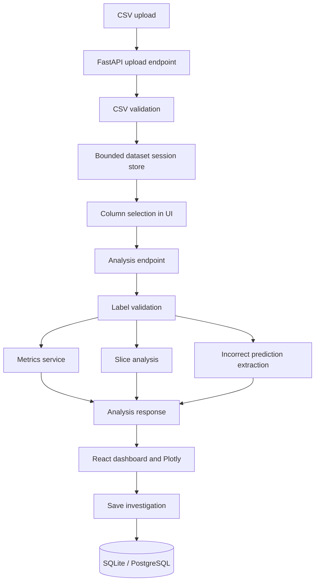

# Architecture

## System context

Model-Failure Atlas accepts a labelled tabular dataset containing feature columns, a ground-truth label column and one or more model prediction columns. It validates the dataset, computes evaluation results, groups observations into user-selected slices, and persists investigation summaries.

## Component responsibilities

1. **React + TypeScript frontend**: file selection, column configuration, result presentation and saved-investigation history.
2. **FastAPI API**: HTTP boundary, request validation, upload limits, orchestration and error responses.
3. **Dataset validation service**: UTF-8 CSV parsing, duplicate-header checks, row/column limits and label completeness.
4. **Analysis service**: coordinates overall metrics, slice metrics, prediction errors and optional model comparison.
5. **Metrics service**: scikit-learn classification metrics and confusion matrix.
6. **Dataset session store**: bounded in-process storage for uploaded DataFrames.
7. **SQLAlchemy persistence**: stores named investigation summaries in SQLite by default; supports a PostgreSQL URL.

## Data flow

## API

- `GET /api/health`: health and runtime-storage description
- `POST /api/datasets`: upload and validate a CSV; returns dataset ID, columns, preview and missing-value counts
- `POST /api/analyze`: calculate metrics and optional slice/model comparison for a dataset session
- `POST /api/investigations`: persist a named analysis summary
- `GET /api/investigations`: list the latest 100 saved summaries
- `GET /api/investigations/{id}`: retrieve one saved summary
- `GET /docs`: interactive OpenAPI documentation

## Storage decisions

Uploaded DataFrames are held in a bounded process-local store (8 datasets maximum). This keeps the MVP easy to run but means uploaded data disappears after a backend restart and is not shared between workers. Saved investigation summaries use SQLAlchemy with SQLite by default. Set `DATABASE_URL` to a PostgreSQL SQLAlchemy URL for a PostgreSQL deployment. A production multi-user release needs durable object/database storage, ownership and access controls, retention rules, and background processing.

## Metric definitions

- Accuracy: proportion of predictions equal to ground truth.
- Precision, recall and F1: weighted averages across observed labels, with zero-division handled as zero.
- Confusion matrix: row = true label, column = predicted label, using sorted union of labels.

Weighted averages are useful summaries but may hide poor results for a small class. A later release should expose per-class metrics and confidence intervals.

## Slice semantics

Categorical features are grouped by observed value. Numeric features with more than five unique values are divided into up to five quantile bins. Rows with missing values in the selected slice feature are excluded from slice groups, but remain in overall metrics. The interface reports missing feature counts. Slice rankings are descriptive; they do not establish causal effects.

## Operational constraints

- Maximum upload size defaults to 10 MiB.
- Maximum rows defaults to 100,000.
- Maximum columns defaults to 100.
- At most 8 datasets are retained in process memory.
- The error explorer returns at most 200 incorrect rows.
- Run one backend worker in this release.
